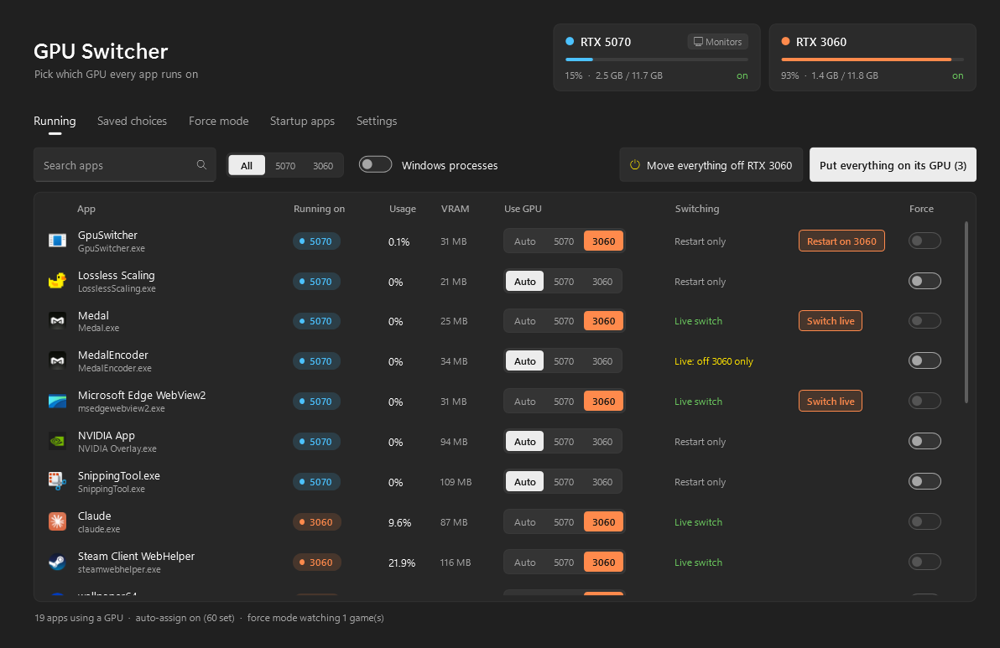
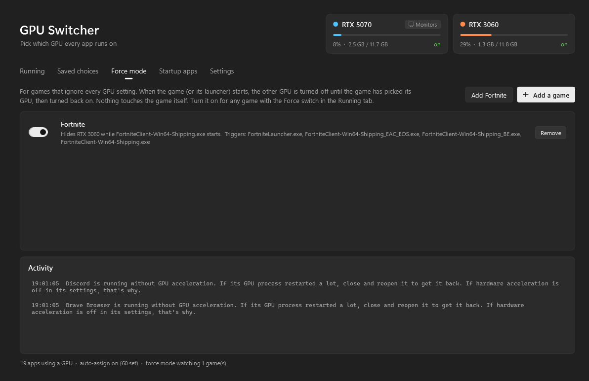
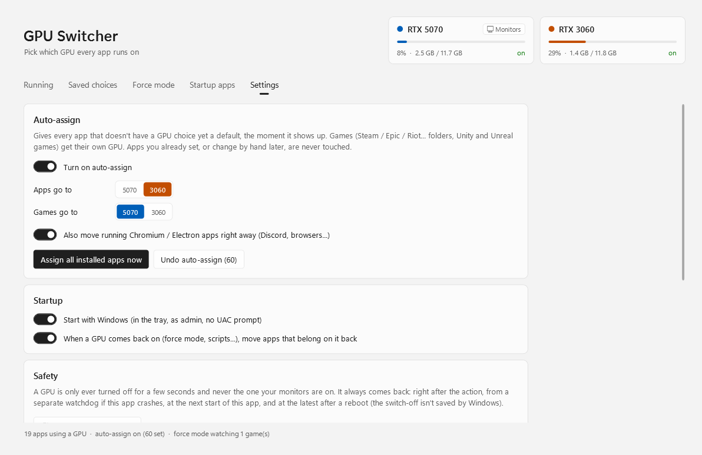
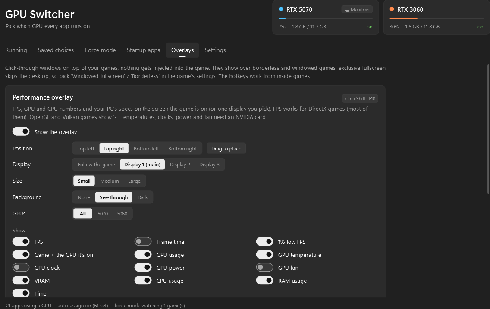

# GPU Switcher

A Windows tray app for PCs with **two (or more) GPUs**. See which GPU every app is running on, pick the GPU per app, and move apps between GPUs without digging through Windows settings.

Made for setups like an RTX 5070 for games + an RTX 3060 for Discord, browsers, OBS and other background stuff. Built with AI ([details](#made-with-ai)).



| Force mode | Settings (light mode) |
|---|---|
|  |  |

## What it does

- **Live view** of every app using a GPU: which GPU it's on, usage and VRAM.
- **Pick a GPU per app** (Auto / GPU 1 / GPU 2). Saved in Windows' own per-app GPU setting, so it works even when GPU Switcher isn't running.
- **Switch running apps**
  - Chromium / Electron apps (Discord, Brave, Chrome, Spotify...) switch **live**: only their GPU process restarts, your tabs and calls stay.
  - Other apps get a one-click **"Restart on GPU X"**.
  - "Move everything off GPU X" turns the second GPU off for ~5 seconds so apps that can handle it move over by themselves.
- **Force mode** for games that ignore every GPU setting (Fortnite / Unreal Engine games pick the GPU with the most VRAM). When the game starts, the other GPU is turned off until the game has picked its GPU, then turned back on. Nothing is injected into the game. Works for any game: add it from the Force mode tab, or flip its Force switch while it runs. Fortnite has a one-click preset.
- **Auto-assign**: new apps get a default GPU, games get their own.
- **Startup apps**: GPU Switcher can launch your startup apps itself, after their GPU choice is fixed (also right after they update into a new folder, like Discord).
- Apps that update into a new version folder keep their GPU choice.
- Windows 11 look: Mica, follows light/dark mode, smooth animations. The GPU your monitors are on is always blue, the second one orange.

### Overlays



Click-through windows on top of your games. Nothing is injected into the game.

- **Performance overlay** (`Ctrl+Shift+F10`): FPS, frame time, 1% lows, the game and which GPU it's on, per-GPU usage / temperature / clock / power / fan / VRAM, CPU and RAM usage, the time, plus an optional spec sheet (CPU, GPUs, RAM, motherboard, Windows, display mode). Pick a corner or drag it anywhere ("Drag to place", double-click or right-click it when done), plus size, background and which GPUs to show. It follows the screen the game is on, or stays on one display you pick.
- **Money covers**: blocks over the spots where a game shows your money, so you can grind without looking and get surprised at the end. Press `Ctrl+Shift+F12` in the game and drag boxes over the money (drag to move, corner to resize, ✕ or right-click to delete, Enter when done). Each game keeps its own covers and they only show while that game is in front. `Ctrl+Shift+F11` reveals the money, press it again to cover it back up.

Limits: overlays show over **borderless / windowed** games, not exclusive fullscreen. FPS comes from DirectX's own frame events (like PresentMon), so it works for DirectX 9-12 games but not OpenGL / Vulkan ones. Temperature, clock, power and fan need an NVIDIA card. Every Roblox experience is the same exe, so they share one set of covers.

## Requirements

- Windows 11, 64-bit (Windows 10 may work, not tested)
- Two or more GPUs. Only tested on **NVIDIA + NVIDIA** so far. AMD / Intel combos may work but aren't tested. Reports welcome!
- Admin rights (needed to turn a GPU off for a few seconds and to manage startup apps)

### Known limits

- **Two identical GPUs** (same model *and* same board maker) can't be told apart: Windows stores per-app GPU choices by model, so it can't either. Same model from different brands is fine.
- **Laptops** (built-in graphics + a gaming GPU) should work but aren't tested. The screen's GPU is never turned off, so force mode can only hide the gaming GPU, not the built-in one.
- **3+ GPUs:** everything works, but force mode only hides one other GPU while a game starts.

## Install

1. Download **`GpuSwitcher-Setup.exe`** from [Releases](../../releases/latest).
2. Open it and click through. That's it, nothing else to install (.NET is included).

The installer puts it in `C:\Program Files\GPU Switcher\`, adds a Start Menu shortcut and (if you leave the box ticked) makes it start with Windows in the tray, as admin, without a UAC prompt. Running the installer again updates it.

Windows SmartScreen may warn about it because it isn't code-signed. Click **More info → Run anyway**, or build it yourself (below).

**Uninstall** from Settings → Apps. It closes GPU Switcher, gives any startup apps it took over back to Windows, removes the startup task and makes sure every GPU is on. Your per-app GPU choices stay in Windows (Settings → Display → Graphics).

## Safety

- A GPU is only ever turned off for a few seconds, and **never the GPU your monitors are on**.
- It always comes back: right after the action, from a separate watchdog process if GPU Switcher crashes, on the next start of GPU Switcher, and at the latest after a reboot (the switch-off isn't permanent in Windows).
- Emergency: run `GpuSwitcher.exe --recover` to turn every GPU back on.
- Give every startup app back to Windows: `GpuSwitcher.exe --restore-startup`.

### Anti-cheat

FORCE mode doesn't touch the game process at all, it only turns a GPU off and on through Windows' device manager while the game launches. Still, there's **no guarantee** every anti-cheat is OK with that. Use at your own risk.

## Build it yourself

Needs the [.NET 8 SDK](https://dotnet.microsoft.com/download/dotnet/8.0).

```
git clone https://github.com/SammyDaBlock/gpu-switcher.git
cd gpu-switcher
dotnet publish -c Release -o publish
```

The exe ends up in `publish\GpuSwitcher.exe` (needs the [.NET 8 Desktop Runtime](https://dotnet.microsoft.com/download/dotnet/8.0) to run).

To build the installer too, install [Inno Setup](https://jrsoftware.org/isinfo.php) (`winget install JRSoftware.InnoSetup`) and run `.\build-release.ps1`. It makes `release\GpuSwitcher-Setup.exe` with .NET included.

## Files

- Settings and logs: `%APPDATA%\GpuSwitcher`
- Per-app GPU choices: Windows' own setting (`HKCU\Software\Microsoft\DirectX\UserGpuPreferences`), the same one Settings → Display → Graphics uses.

## Made with AI

Full transparency: I came up with the idea, decided what it should do and tested it on my own PC, but the code was written with [Claude Code](https://claude.com/claude-code), Anthropic's AI coding tool. Every commit lists Claude as co-author. If you find a bug, please [open an issue](../../issues).

## License

[MIT](LICENSE)
